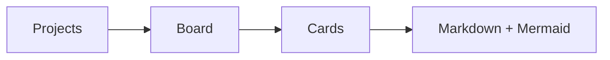

## Why

Prove the concept: projects, columns, cards, and rich markdown.

## Demo

This very card renders **markdown**, code, images, and diagrams:

```js
const board = await openBoard('localhost:5173');
board.render(['markdown', 'mermaid', 'images']);
```




