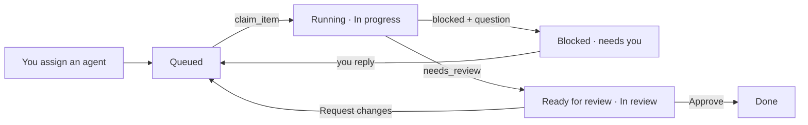

# Agentic Kanban

A local project board in the style of GitHub Projects, built so autonomous agents like Claude can
work it alongside you: pick up queued items, post progress, ask questions, and hand finished work
back for review. Everything updates live in the browser.

## Run it

```bash
npm install
npm run dev        # UI + API on http://localhost:5173
```

For a production build: `npm run build && npm start`.

The board is stored in `data/board.json` (one file — commit it, back it up, or point
`KANBAN_DATA` somewhere else).

## Connect Claude

`.mcp.json` registers the board's MCP server for Claude Code in this folder. With the app running,
Claude gets these tools:

| Tool | What it does |
| --- | --- |
| `list_projects`, `list_items`, `get_item` | Read the board |
| `next_item` | The most urgent item queued for this agent |
| `claim_item` | Start work: assigns the agent, state → running, Todo → In progress |
| `report_progress` | Post an update; set state `running` / `blocked` / `needs_review` / `idle`; link a branch, PR or session |
| `comment`, `update_item`, `create_item` | Talk, edit fields, split out follow-ups |

To use it from another project, add the server with an absolute path:

```bash
claude mcp add kanban -e KANBAN_URL=http://localhost:5173 -e KANBAN_AGENT=claude -- node /path/to/open-agentic-kanbaan/server/mcp.mjs
```

`KANBAN_AGENT` is the actor the agent acts as. Add more agents with
`POST /api/actors {"name": "Reviewer bot", "kind": "agent"}`.

## How the handoff works



Items waiting on you show a red badge in the sidebar and under the **Needs you** filter.

## Filters

`status:todo` `assignee:claude` `assignee:@agents` `assignee:none` `label:bug` `priority:high`
`size:m` `agent:running` `is:needs-you` `is:open`, any free text, and `-` to negate (`-label:bug`).

## HTTP API

The UI and the MCP server both use it, so scripts can too: `GET /api/state`,
`GET /api/events` (server-sent events), `/api/projects[/:id]`,
`/api/projects/:id/items[/:number]` with `/comments`, `/agent`, `/claim`, and `GET /api/next?agent=`.
See [server/api.mjs](server/api.mjs).
