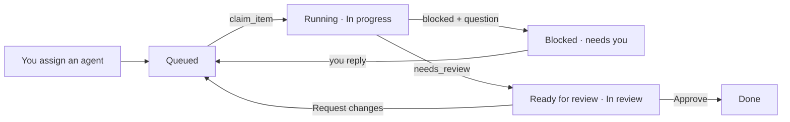

# Agentic Kanban

A local project board in the style of GitHub Projects, built so autonomous agents like Claude can
work it alongside you: pick up queued items, post progress, ask questions, and hand finished work
back for review. Everything updates live in the browser.

## Run it

```bash
npm install
npm run dev        # UI + API on http://localhost:5173
```

For a production build: `npm run build && npm start`.

## Where the data lives

The code is public; your board is not part of it. Data lives in a separate folder, by default
`~/Developer/kanban-data` (override with `KANBAN_DATA_DIR`), one file per item so it diffs and merges well:

```
actors.json
<project>/project.json
<project>/items/<n>.md               YAML front matter + markdown body (hand-editable)
<project>/items/<n>.activity.jsonl   timeline, append-only
```

The server watches the folder, so hand edits and `git pull` show up live. On first start it creates
the folder, runs `git init`, and auto-commits changes (about a minute after the last change, with a
readable message like `demo#4: claude → needs_review`). A fresh folder gets a small demo project
(or imports an old `data/board.json` / `KANBAN_IMPORT_JSON` if present).

To back it up and sync between machines, add a private remote; the server then pulls every ~5 minutes
and pushes after each commit (never force-pushes; git errors are logged, never fatal):

```bash
cd ~/Developer/kanban-data && gh repo create <name> --private --source . --push
```

On a merge conflict the local version wins and the other device's version is recorded in the item's activity
(project/actor files: saved under `.conflicts/`). Sync health is at `GET /api/sync` and shown in the top bar.
Only one server can use a data dir at a time (`.kanban.lock`). The server listens on `127.0.0.1`; set `HOST` to change that
(there is no auth), and write requests must be `application/json`.

Env: `KANBAN_GIT_SYNC=0` turns git off, `KANBAN_COMMIT_DELAY_MS` (default 60000) and
`KANBAN_COMMIT_MAX_MS` (300000) tune the debounce.

## Always on (macOS)

```bash
scripts/install-launchd.sh      # builds, then runs the board at login on http://localhost:5173
scripts/uninstall-launchd.sh
```

It writes `~/Library/LaunchAgents/com.agentic-kanban.board.plist` (logs: `~/Library/Logs/agentic-kanban.log`).
Stop `npm run dev` first since both use port 5173; `PORT` and `KANBAN_DATA_DIR` are read from the environment at install time.

## Connect Claude

`.mcp.json` registers the board's MCP server for Claude Code in this folder. With the app running,
Claude gets these tools:

| Tool | What it does |
| --- | --- |
| `list_projects`, `list_items`, `get_item` | Read the board |
| `next_item` | The most urgent item queued for this agent |
| `claim_item` | Start work: assigns the agent, state → running, Todo → In progress |
| `report_progress` | Post an update; set state `running` / `blocked` / `needs_review` / `idle`; link a branch, PR or session |
| `comment`, `update_item`, `create_item` | Talk, edit fields, split out follow-ups |
| `find_project`, `create_project`, `link_repo` | Find the project for the current repo, or set one up |

To use it from every repo, add the server once for your user, with an absolute path:

```bash
claude mcp add --scope user kanban -e KANBAN_URL=http://localhost:5173 -e KANBAN_AGENT=claude -- node /path/to/open-agentic-kanban/server/mcp.mjs
```

Link each project to its code repos (in **Project settings → Linked repos**, or with `link_repo`).
An agent in a repo then finds its project with `find_project`, passing the git remote or folder
name, and works that project's queue.

`KANBAN_AGENT` is the actor the agent acts as. Add more agents with
`POST /api/actors {"name": "Reviewer bot", "kind": "agent"}`.

### Coordinating several agents

[agent-coordinator](https://github.com/takasurazeem/agent-coordinator) is a Claude Code plugin
with two skills: `coordinator` (background agents) and `session-coordinator` (sessions you can
watch and steer). When this board is connected, Claude takes work from the queue, hands each piece
to an agent picked for it, and posts progress to the items. You still approve the results.

## How the handoff works



Items waiting on you show a red badge in the sidebar and under the **Needs you** filter.

## Filters

`status:todo` `assignee:claude` `assignee:@agents` `assignee:none` `label:bug` `priority:high`
`size:m` `agent:running` `is:needs-you` `is:open`, any free text, and `-` to negate (`-label:bug`).

## HTTP API

The UI and the MCP server both use it, so scripts can too: `GET /api/state`,
`GET /api/events` (server-sent events), `/api/projects[/:id]`,
`/api/projects/:id/items[/:number]` with `/comments`, `/agent`, `/claim`, and `GET /api/next?agent=`.
See [server/api.mjs](server/api.mjs).
